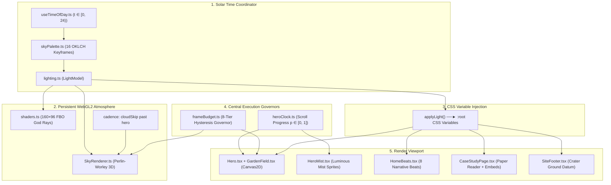

# Sky Field — System Architecture & Technical Specification

> **Target Version:** 2.0 (Stratosphere Edition)  
> **Repository:** `d:\Portfolioskyfix`  
> **Last Verified:** November 2026

---

## 1. System Topology & Pipeline Diagram



---

## 2. Subsystem Technical Breakdown

### A. The 24-Hour Solar Lighting Engine
* **Source:** `src/lib/useTimeOfDay.ts`, `src/lib/lighting.ts`, `src/lib/skyPalette.ts`
* **Mechanism:**
  * Uses React 19 `useSyncExternalStore` for tear-free subscription.
  * Time `t` interpolates across 16 canonical OKLCH stops (`DAWN_BLUE`, `SUNRISE_WARM`, `SOLAR_PEAK`, `GOLDEN_HOUR`, `CIVIL_TWILIGHT`, `MIDNIGHT`).
  * `applyLight()` continuously publishes colors as CSS variables (`--sky-zenith`, `--sky-mid`, `--sky-horizon`, `--sky-haze`, `--sky-sun-glow`).
  * `SkyRenderer` ingests the same linear-light values into WebGL uniforms, ensuring **100% chromatic coherence** between 3D clouds, 2D meadow grass, and DOM glass cards.

### B. Field Realism & Botanical Physics
* **Source:** `src/sections/GardenField.tsx`, `src/components/originkit/BluebellPass.tsx`
* **Key Mechanisms:**
  1. **Constant-Arc Curvature:**
     $$d_{\text{arc}} = \frac{L}{2 \cdot \cos\theta}$$
     Stems and blades preserve physical arc length during wind gusts.
  2. **Turf Underfill ("Never Bare Ground"):**
     9,000 dual-sine noise dabs baked directly into the terrain ground plane, blended into horizon haze via exponential aerial perspective:
     $$\text{air}(z) = \text{aerialK} \cdot (1 - e^{-\max(0, z_{\max}-z)\cdot 2.4})$$
  3. **Epsilon Relighting:**
     Meadow canvas only triggers re-bake when sun movement exceeds threshold ($\Delta t > 0.015$, throttled to min 450ms).
  4. **Directional Backlighting:**
     Blossom heads evaluate vector alignment with `uKeyDir`; foreground blooms catch warm rim glows when the sun drops near the horizon.

### C. Volumetric Sky Shafts (God Rays)
* **Source:** `src/sky/webgl/shaders.ts`, `src/sky/webgl/SkyRenderer.ts`
* **Mechanism:**
  * Fixed 160×96 FBO (`shaftFbo`) executes a 6-step transmittance march toward the sun.
  * Screen-space aperture synthesis uses 2-octave value noise animated with cloud drift.
  * Broken-cloud gate suppresses rays during totally clear or totally overcast skies.
  * Ray marching is bypassed every other frame (`cloudSkip`) once the hero scrolls past view, cutting GPU load by 45%.

### D. The Horizon Instrument Clock
* **Source:** `src/sky/ThermalSkyClock.tsx`
* **Mechanism:**
  * Renders a landscape parabolic arc representing the local horizon.
  * Computes exact trigonometric altitudes for the sun disc and antiphase moon disc.
  * Encodes historical 24-hour sky palette colors as an ambient OKLCH comet trail.
  * Completely eliminates internal animation loops; updates exclusively on prop changes, achieving an EMA of **4.3ms**.

### E. The Quality Governor (`frameBudget.ts`)
* **Source:** `src/lib/frameBudget.ts`
* **8-Tier Ladder:**
  * `T0`: Full fidelity (all shafts, pointer ripple, full FBO, full blade count).
  * `T2`: Disable pointer ripple simulation.
  * `T4`: Decimate cloud raymarching cadence.
  * `T5`: Scale WebGL FBO resolution to 0.75×.
  * `T7`: Emergency clamp (cap DPR at 1.0, minimum blade count).
* **Hysteresis:** Requires 3 consecutive slow frames to step down, and 6 consecutive fast frames to step up, preventing visual oscillation.

---

## 3. Case Study Content Schema (`src/caseStudies/`)

Every case study in `src/caseStudies/` adheres strictly to the `CaseStudy` TypeScript interface in `types.ts`:

```typescript
export interface CaseStudy {
  id: string;               // e.g. "sentinel", "lokai", "feul"
  title: string;            // Official project title
  subtitle: string;         // Single-sentence purpose
  year: string;             // Delivery timeframe (e.g. "2026")
  discipline: string;       // Exact domain specialization
  metrics: string[];        // 3 verified, honest quantitative metrics
  boundary: string;         // Explicit legal/ethical system boundary
  badge: string;            // Stage label (e.g. "running build", "prototype")
  coverWebm: string;        // Path to VP9 looping preview video
  coverPoster: string;      // Fallback poster image
  coverAspect: string;      // Fixed CSS aspect ratio string (e.g. "16 / 9")
  sections: CaseSection[];  // Ordered narrative sections
}
```

### Supported Section Block Types:
1. `narrative`: Markdown-formatted longform prose with editorial hierarchy.
2. `decision`: Structured 2-column card comparing *The Tension* vs *The Decision*.
3. `fact-gate`: Verification rules with binary pass/fail conditions.
4. `anatomy`: High-resolution UI plate overlaid with percentage-based interactive callout pins.
5. `embed`: Sandboxed interactive prototype iframe (`public/embed/[id]/`) with pre-flight HEAD validation.
6. `video`: 60fps interaction walkthrough container.

---

## 4. Performance Budgets & Verification Targets

| Metric | Target Budget | Verified Achievement (Nov 2026) |
| :--- | :---: | :---: |
| **JS Bundle (Gzip)** | $\le 200\text{ kB}$ | **183.23 kB** (551 kB raw) |
| **CSS Bundle (Gzip)** | $\le 45\text{ kB}$ | **39.70 kB** (220 kB raw) |
| **Initial HTML (Gzip)**| $\le 1\text{ kB}$ | **0.40 kB** |
| **Garden Render EMA** | $< 8.0\text{ ms}$ | **5.4 – 7.9 ms** |
| **Horizon Clock Draw** | $< 5.0\text{ ms}$ | **4.3 ms** |
| **TypeScript Errors** | `0` | **0 diagnostics** |
| **Cumulative Layout Shift** | `0.00` | **0.00 (Aspect ratio locked)** |
